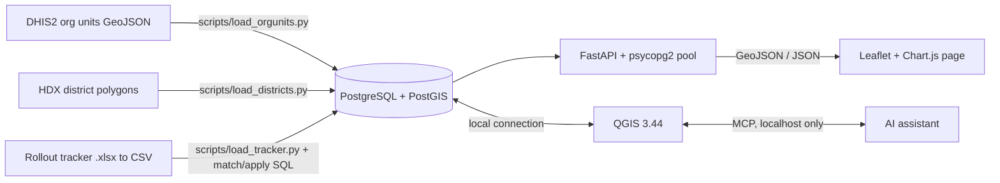

# FacilityGeo

A database-driven web app that shows where a health-information-system rollout stands across health facilities in Malawi, where the gaps are, and which support officer is closest to each facility.


> **Data note.** Facility locations are real (DHIS2 organisation units), district polygons are real (HDX), and rollout and training status come from the real rollout tracker (59 facilities, of which 47 match a DHIS2 facility). The tracker lists only about 5% of the 908 facilities, so every other facility is shown as **Not in tracker** (status unknown, not "not started"). The four **support officers are simulated**, and the app says so on screen. The tracker has no equipment, internet or power columns, so those are not shown. No patient or personal data is held. The real tracker file is not in Git.

## 1. The problem

The rollout team tracks progress in a spreadsheet. A spreadsheet cannot answer location questions:

- Which facilities are not live yet, and are they clustered?
- Which districts are falling behind?
- Which facilities have no internet or no power, and need a different approach?
- Which support officer is nearest to each facility, and which facilities are far from every officer?

## 2. The solution

Facilities live in PostGIS. The API answers those questions with spatial SQL and a Leaflet page draws the answers on a map.

| Question | Spatial method |
|---|---|
| Facilities within N km of a point | `ST_DWithin` on `geography` (metres) |
| Nearest support officer | KNN `<->` to pick 3 candidates, then `ST_Distance(::geography)` for the true nearest |
| Clusters of not-started facilities | `ST_ClusterDBSCAN` in EPSG:32736 (metres), with `ST_ConvexHull` outlines |
| % live per district | `ST_Contains` / `GROUP BY` (cross-checked in QGIS) |
| Matching tracker rows to facilities | DHIS2 code, exact name, core name (type words removed, unique in the district), then `pg_trgm` fuzzy name, then reviewed manual matches |

## 3. Architecture



- **Database:** local PostgreSQL 17 with PostGIS 3.7 and `pg_trgm`. No Docker.
- **API:** FastAPI, parameterised queries only, inputs validated with pydantic. `/docs` has the interactive reference.
- **Frontend:** one HTML file, Leaflet and Chart.js vendored in `frontend/vendor/` (works offline apart from map tiles). No build step.
- **QGIS:** project `qgis/facilitygeo.qgz` with styled layers and cross-checks against PostGIS.

## 4. Setup (local PostgreSQL)

Requirements: PostgreSQL with PostGIS, Python 3.10+, optionally QGIS.

**1. Create the database and an application role.** Run these yourself in a terminal. `\password` asks for the password interactively, so it is never written in a file or a command line:

```bash
createdb facilitygeo
psql -d facilitygeo -c "CREATE ROLE geo LOGIN"
psql -d facilitygeo -c "\password geo"
```

**2. Create the tables** (run as the database owner, once; safe to re-run). It also grants the `geo` role data access only, with no right to change the schema:

```bash
psql -d facilitygeo -f database/setup.sql
```

**3. Configure the connection.** Copy `.env.example` to `.env` and fill in the values. `.env` is ignored by Git. Environment variables work too.

```
DB_HOST=localhost
DB_PORT=5432
DB_NAME=facilitygeo
DB_USER=geo
DB_PASSWORD=<your password>
```

**4. Install and load the data** (from this folder):

```bash
python3 -m venv .venv && source .venv/bin/activate
pip install -r requirements-dev.txt

python scripts/load_orgunits.py "/path/to/Organisation units.geojson"   # 908 facilities -> orgunits_raw
python scripts/load_districts.py data/mw_districts.geojson              # 28 HDX polygons
psql -d facilitygeo -f database/build_facilities.sql                    # orgunits_raw -> facilities
psql -d facilitygeo -f database/checks.sql                              # read-only data-quality report

python scripts/xlsx_to_csv.py "/path/to/tracker.xlsx" data/tracker.csv  # only if the tracker is a spreadsheet
python scripts/load_tracker.py data/tracker.csv                         # headers matched by name
psql -d facilitygeo -f database/match_tracker.sql                       # code -> exact -> core name -> fuzzy; lists unmatched rows
psql -d facilitygeo -f database/apply_tracker.sql                       # copy matched values into facilities
psql -d facilitygeo -f database/assign_officers.sql                     # 4 fictional officers + nearest assignment
```

`data/mw_districts.geojson` is made from the HDX shapefile with `ogr2ogr` (the exact command is in the header of `scripts/load_districts.py`).

`match_tracker.sql` also applies `database/manual_matches.sql` (decisions made by hand, keyed by tracker name and district). To resolve an unmatched row, add one line there, then re-run `match_tracker.sql` and `apply_tracker.sql`.

The tracker needs a facility name and a district. It may also have a go-live status, an end-user training status, a DHIS2 code, a go-live date, devices, staff trained, internet and power. Missing columns stay empty and are never invented. Facilities with no tracker row become `not_in_tracker`.

If you have no tracker, `python scripts/make_simulated_tracker.py` writes a clearly labelled **simulated** one to `data/`. A 20-row simulated sample is in `sample_data/tracker_sample.csv`. The `data/` folder is ignored by Git so real files are never committed.

**5. Run and check:**

```bash
uvicorn app.main:app --reload          # http://127.0.0.1:8000  (map)   /docs  (API)
curl http://127.0.0.1:8000/health      # {"status":"ok", ...}
pytest -q                              # 16 tests against the live database
```

## 5. API

| Endpoint | Purpose |
|---|---|
| `GET /health` | database and PostGIS check |
| `GET /facilities?status=&district=&limit=` | GeoJSON of facilities (status: `not_in_tracker`, `not_started`, `in_progress`, `live`) |
| `POST /facilities` | add a facility (validated, nearest officer assigned) |
| `PATCH /facilities/{id}/status` | change rollout status |
| `GET /stats/summary`, `GET /stats/districts?sort=` | KPIs (tracked, live, training) and % live of tracked facilities per district |
| `GET /districts`, `GET /officers` | polygons with % live; officers |
| `GET /analysis/nearest-officer?facility_id=` | nearest officer and distance |
| `GET /analysis/within-radius?lat=&lon=&radius_km=&status=` | facilities in a circle |
| `GET /analysis/clusters?eps_km=15&min_points=5&status=not_started` | DBSCAN clusters with hulls |
| `GET /analysis/no-connectivity` | no internet and/or no power |
| `GET /analysis/far-from-officer?km=100` | facilities far from every officer |
| `GET /reports/missing-coordinates` | data-quality report |

## 6. QGIS and the MCP connection

 

Open `qgis/facilitygeo.qgz` in QGIS 3.44. Layers read the local database through a QGIS connection that you create yourself (**Layer > Data Source Manager > PostgreSQL**); the project stores no password. Styles are in `qgis/styles/`.

To let an AI assistant drive QGIS:

1. Copy `qgis_mcp_plugin/` from the parent repository into your QGIS profile `python/plugins` folder and enable **QGIS MCP**.
2. In QGIS: **Plugins > QGIS MCP > Start Server**. It listens on `localhost:9876` only. Do not expose this port to a network.
3. Add the server to your MCP client (`uv --directory .../src/qgis_mcp run qgis_mcp_server.py`).

Safety rules used in this project: no code is run through the `execute_code` tool without reviewing it first, nothing is deleted, and nothing is written to the database from QGIS without approval.

`scripts/compare_qgis_checks.py` compares PostGIS with two QGIS processing outputs. District counts agree exactly (903 facilities in a polygon; 5 fall outside every polygon). The nearest officer differs for 3 facilities that sit almost equally far from two officers (the two distances differ by only 430 to 632 m): QGIS measures in degrees, PostGIS in metres.

## 7. Data sources

| Data | Source | Status |
|---|---|---|
| 908 facility points | DHIS2 organisation units export (UID = `facility_code`) | real |
| 28 district polygons | HDX Malawi administrative boundaries | real, coarse |
| Rollout and training status | Rollout tracker spreadsheet: 59 facilities, 47 matched to DHIS2 | real, small |
| Devices, internet, power, go-live dates | not in the tracker | not available (empty) |
| Support officers | `database/assign_officers.sql` | **simulated** |
| Simulated tracker (for demos without the real file) | `scripts/make_simulated_tracker.py` | **simulated** |

## 8. Limitations

- **The tracker covers 59 facilities (about 5% of 908).** 861 facilities are `not_in_tracker`; their rollout status is unknown. "% live" is the share of the 47 matched tracked facilities (7 live = 14.9%). A district with one tracked facility can show 100%, so the chart prints the tracked count next to each percentage.
- **12 of the 59 tracker rows are not matched**, so they are not on the map: Amecca, Chipande, Kachere, Khungulu, Nancholi and Ntonda (not found in Blantyre in DHIS2); Soche Health Centre, Biwi Health Centre, Kaluluma HC and Mzuzu Central Hospital (no safe candidate); Chilomoni and Zingwangwa (each has two DHIS2 records, a health centre and a BLM clinic, and the choice was not guessed). Biwi Health Centre is the tracker's only "In Progress" row, so the app shows 0 in progress. Resolve them in `database/manual_matches.sql`.
- The tracker has no DHIS2 codes, so matching is by name. Core-name and fuzzy matches are listed by `match_tracker.sql` for review. Kamuzu Central Hospital is matched by hand to DHIS2's "Lilongwe Central Hospital".
- Support officers are simulated, so nearest-officer results show the method, not real staffing. 158 of 908 facilities are more than 100 km from the nearest simulated officer.
- **No authentication.** The API and page are for localhost use. A production version needs sign-in, roles and HTTPS.
- Local PostgreSQL uses `trust` authentication on localhost, so a wrong password is accepted. Use `scram-sha-256` in `pg_hba.conf` for anything shared.
- HDX polygons are coarse: 5 facilities fall outside every polygon. DHIS2 splits Mzimba into North and South, HDX has one polygon.
- Some coordinates look wrong (for example Zoa Dispensary, Kabuwa HC, Khosolo HC) and there is one duplicate DHIS2 org-unit pair. They are reported by `database/checks.sql` and not changed.
- Distances are straight lines, not road distances (pgRouting is not installed), so "nearest officer" is not travel time.
- DBSCAN results depend on the distance setting and the status chosen. The default (not started, 15 km, at least 5) finds one cluster of 24 facilities in Blantyre and Chiradzulu.

## 9. Repository layout

```
app/        FastAPI app (config, db pool, schemas, endpoints)
database/   setup.sql and the loading / matching / analysis SQL
scripts/    loaders, xlsx converter, simulated tracker, QGIS cross-check
frontend/   index.html + vendored Leaflet and Chart.js
qgis/       project file and QML styles
tests/      API tests
docs/       screenshots and the video script
```
